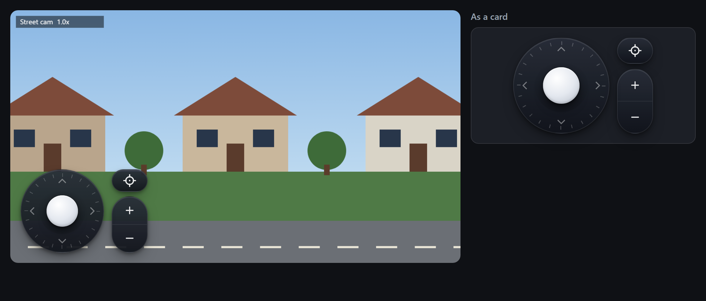

# Arcane PTZ Joystick

A joystick for pan-tilt-zoom cameras in Home Assistant. Drag the knob in any direction and the camera pans and tilts together, faster the further you drag. Let go and it stops. Hold + or − to zoom. With tap-to-aim, tap the picture and the camera turns to that spot, or draw a box and it zooms in to it.

[![hacs][hacs-badge]][hacs-link]
[![Buy Me a Coffee][bmc-badge]][bmc-link]



- **Any direction, any speed.** Diagonals too, not just four arrow buttons. Gentle near the centre, full speed at the rim.
- **Hold to zoom**, and double-tap − to zoom all the way out.
- **Tap to aim** and **draw a box to zoom** (Hikvision scripts included).
- Sits **on top of your camera picture** (Advanced Camera Card, picture-elements) or as a **card of its own**.
- Made for touch: no page scrolling while you drag, and a small vibration in the Home Assistant app.
- A visual editor in the dashboard card picker.

## Install

### HACS (recommended)

1. In HACS, open the three-dot menu, choose **Custom repositories**, add `https://github.com/deekay2153/arcane-ptz-joystick` with the type **Dashboard**.
2. Search for **Arcane PTZ Joystick** and download it.
3. Reload your browser.

### By hand

1. Download `arcane-ptz-joystick.js` from the [latest release](https://github.com/deekay2153/arcane-ptz-joystick/releases/latest).
2. Put it in `config/www/`.
3. In **Settings → Dashboards → ⋮ → Resources**, add `/local/arcane-ptz-joystick.js` as a **JavaScript module**.

## Step 1: add the scripts

The card moves your camera by calling scripts, so it works with any camera Home Assistant can move. Two ready-made sets are in the [examples](examples) folder:

| Your camera | File | What you get |
| --- | --- | --- |
| Hikvision, through the [Hikvision Next](https://github.com/maciej-or/hikvision_next) integration | [`hikvision_next.yaml`](examples/hikvision_next.yaml) | Smooth moves at any speed, zoom, zoom all the way out, tap-to-aim and box zoom |
| Anything with ONVIF (Reolink, Amcrest, Dahua, Tapo, Hikvision and more), through Home Assistant's [ONVIF](https://www.home-assistant.io/integrations/onvif/) integration | [`onvif.yaml`](examples/onvif.yaml) | Moves in any direction (one speed for both axes) and zoom. No tap-to-aim. |

Open the file, change `camera: camera.my_ptz_camera` to your camera in each script, and add the scripts in one of two ways:

- **As a package:** save the file as `config/packages/ptz.yaml`, make sure your `configuration.yaml` has

  ```yaml
  homeassistant:
    packages: !include_dir_named packages
  ```

  and restart Home Assistant.
- **In the script editor:** for each script, go to **Settings → Automations & scenes → Scripts → Add script → ⋮ → Edit in YAML**, paste the part under the script's name, and save it with the same id (for example `ptz_move`).

The ONVIF scripts haven't been tried on every brand yet. If yours needs a change, please [open an issue](https://github.com/deekay2153/arcane-ptz-joystick/issues).

### Your own scripts

Any script works if it accepts these fields:

| Script | Called with | Must do |
| --- | --- | --- |
| `script` (move) | `pan`, `tilt`: whole numbers from −100 to 100 (right and up are positive) | Move at that speed until the next call. `0`, `0` = stop. Should return quickly: the card waits for it before sending the next speed. |
| `zoom_in_script`, `zoom_out_script` | nothing | Start zooming |
| `zoom_stop_script` | nothing | Stop zooming |
| `zoom_out_full_script` | nothing | Zoom all the way out (optional) |
| `aim_script` | `x`, `y`: percent of the picture from its left and top edge. With a box also `x2`, `y2` (its bottom-right corner). | Turn to that spot, or zoom in to the box |

While you drag, the card sends a new `pan`/`tilt` only when the speed changes (in steps of 5), and at most one call at a time. When you let go it sends `0`, `0`, and a second time a moment later in case the first was lost.

## Step 2: add the card

### On top of the camera picture

With [Advanced Camera Card](https://github.com/dermotduffy/advanced-camera-card), put the joystick in its `elements`:

```yaml
type: custom:advanced-camera-card
cameras:
  - camera_entity: camera.my_ptz_camera
elements:
  - type: custom:arcane-ptz-joystick
    card: false
    script: script.ptz_move
    zoom: true
    zoom_in_script: script.ptz_start_zoom_in
    zoom_out_script: script.ptz_start_zoom_out
    zoom_stop_script: script.ptz_stop
    zoom_out_full_script: script.ptz_zoom_out_full
    aim: true
    aim_script: script.ptz_aim
    size: 150
    style:
      left: 12%
      top: 82%
```

The same works in Home Assistant's own **picture-elements** card.

### As a card of its own

Add **Arcane PTZ Joystick** from the card picker and pick your scripts in the editor, or paste:

```yaml
type: custom:arcane-ptz-joystick
script: script.ptz_move
zoom: true
zoom_in_script: script.ptz_start_zoom_in
zoom_out_script: script.ptz_start_zoom_out
zoom_stop_script: script.ptz_stop
```

Put it next to your camera card. Tap-to-aim finds the camera picture nearest to it on the same view.

## Options

| Option | Default | |
| --- | --- | --- |
| `script` | `script.ptz_move` | The move script |
| `max_speed` | `70` | Speed at the rim, 5 to 100 |
| `size` | `150` | Size of the ring in pixels |
| `zoom` | `false` | Show the + / − buttons |
| `zoom_in_script` | `script.ptz_start_zoom_in` | |
| `zoom_out_script` | `script.ptz_start_zoom_out` | |
| `zoom_stop_script` | `script.ptz_stop` | |
| `zoom_out_full_script` | none | Double-tap − to run it |
| `aim` | `false` | Show the tap-to-aim button |
| `aim_script` | `script.ptz_aim` | |
| `arrange` | `side` | Where the aim and zoom buttons go: `side` (stacked beside the ring), `row` (in a row beside it) or `stack` (in a row under it) |
| `card` | `true` | Card background. Set `false` when the joystick sits on a camera picture. |

The accent colour (the glow while you drag and the armed aim button) follows your theme's primary colour. To change it, set `--ptz-joystick-accent` in your theme or with card-mod.

## Tap to aim

Tap the aim button (it pulses), then:

- **tap** a spot on the picture and the camera turns to it, or
- **drag a box** and the camera zooms in to it.

The button stays armed so you can tap again. It switches itself off after 20 seconds, or tap it again. Buttons and menus on the picture keep working while it is armed.

## Try it without Home Assistant

`preview/index.html` runs the card on a made-up camera. From the repo folder:

```
python -m http.server 8800
```

then open <http://127.0.0.1:8800/preview/index.html>. Add `?arrange=row` or `?arrange=stack` to try the other layouts.

## Support

If this joystick makes your camera nicer to drive, you can [buy me a coffee][bmc-link]. Thank you!

Found a bug or have an idea? [Open an issue](https://github.com/deekay2153/arcane-ptz-joystick/issues).

## Licence

MIT, see [LICENSE](LICENSE).

[hacs-badge]: https://img.shields.io/badge/HACS-Custom-41BDF5.svg
[hacs-link]: https://hacs.xyz
[bmc-badge]: https://img.shields.io/badge/Buy%20me%20a%20coffee-FFDD00?logo=buymeacoffee&logoColor=black
[bmc-link]: https://www.buymeacoffee.com/deekay2153
